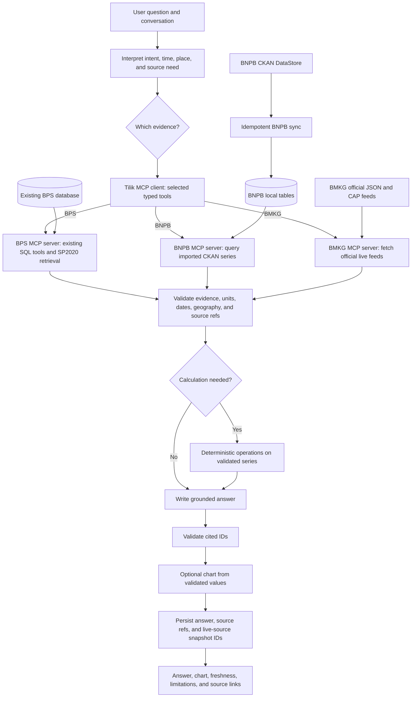

# Tilik connector migration plan

Status: implementation roadmap. The connector code, schema migration, API,
workspace selector, and Docker Compose services are implemented. Live
database-plus-LLM conversation acceptance remains for the user's later test.

## Outcome and release scope

Tilik becomes an Indonesian data analyst with three source connectors. BPS supplies
published statistical observations and the existing SP2020 publication. BNPB
supplies historical disaster series. BMKG supplies live forecasts, earthquake
reports, and active weather warnings. The agent can answer from one source or
combine compatible evidence from two sources, while naming each source and its
time and geographic scope.

The first release covers:

- Existing BPS questions with no intended behavior regression.
- BNPB's public CKAN DataStore resources for disaster counts by province and
  district, counts by disaster type, and people affected by disaster type for
  2010–2024. These are distinct aggregate series: the currently sampled
  resources do **not** establish flood counts by province.
- BMKG's official latest and recent earthquake feeds, three-day village
  forecasts, and active CAP weather warnings.
- One BPS + BNPB province/year comparison. A BMKG + BNPB response may place a
  current warning beside a historical record, but does not predict an event.

No agency-operated MCP server is required. **Tilik owns three source MCP
servers**: BPS reads the existing local database and publication collection;
BNPB reads synchronized local tables; BMKG calls official live feeds. Tilik's
agent is the MCP client. Start by converting BPS and prove that existing BPS
questions still work through MCP before adding the other servers. The Python
source adapters remain reusable behind the MCP tools.

## Source findings that constrain the design

- BNPB's public CKAN `package_show` and `datastore_search` calls succeeded without
  credentials. The sampled dataset has 38 resources. Its direct XLSX download
  returned an access-check 403, so the implementation uses the documented
  DataStore API and does not depend on the direct file URL.
- The sampled BNPB tables have different shapes: 38 province rows, 510 district
  rows, nine national disaster-type rows, and nine national affected-person rows.
  Year columns arrive as strings such as `2010.0`; district codes may arrive as
  strings such as `1101.0`. The parser must validate and normalize these fields.
- The province table has nonzero historical values for some of today's new Papua
  provinces. A current province label is not proof of a comparable historical
  boundary. Cross-year province claims involving those areas must carry a
  source-backed comparability decision or be withheld.
- BMKG returned forecast JSON, earthquake JSON, an RSS warning list, and CAP
  warning detail without credentials. Forecasts have a production timestamp;
  CAP warnings have effective and expiry times. BMKG documents a 60 request per
  minute per IP limit and requires visible attribution.
- BMKG's forecast endpoint requires a level-four administrative code (`adm4`).
  Location name resolution must use a validated code catalog; an unverified name
  match must not trigger a forecast request.

Official entry points: [BMKG forecast](https://data.bmkg.go.id/prakiraan-cuaca/),
[BMKG earthquakes](https://data.bmkg.go.id/gempabumi/),
[BMKG warnings](https://data.bmkg.go.id/peringatan-dini-cuaca/),
[BNPB dataset metadata](https://data.bnpb.go.id/api/3/action/package_show?id=data-bencana-indonesia),
and [BNPB DIBI methodology](https://dibi.bnpb.go.id/superset/dashboard/tentang-dibi/).

The first BNPB sync uses this fixed resource allowlist from that package:

| Measure and grain | CKAN resource ID |
| --- | --- |
| Disaster events, all types, province × year | `5dfcae7e-acb3-4548-82b5-61d876ea478a` |
| Disaster events, all types, district × year | `21044ffd-c397-4b3c-acbd-5adaa03d79e3` |
| Disaster events, type × year, national | `9b41007e-c998-456b-8cbc-385b17986e46` |
| People affected, type × year, national | `7f9e5218-bbba-4916-a2b8-13cf1764dc96` |

Resolve these IDs through the package catalog at sync time, and fail visibly if
their declared shape changes. Do not silently substitute a similarly named
resource.

## Target flow

The graph routes by **evidence capability**, not by one universal row shape.
`SeriesEvidence` carries a measure, period, geography, unit, values, coverage,
and source reference. `EventEvidence` carries an event time and location.
`AlertEvidence` adds issue/effective/expiry times and affected areas. Every
evidence item also has a stable connector name, source URL, retrieval time, and
source-specific ID. Raw panels and full feed payloads remain outside model
context; the model sees bounded summaries and verified calculations.

## Interfaces and storage decisions

- Add optional `sources: list["bps" | "bnpb" | "bmkg"] | null` to
  `QuestionRequest`. `null` means automatic routing; a nonempty list limits
  available connectors. Use the same request in `/questions` and
  `/questions/stream`, with no new endpoint. Keep the existing `source_route`
  field for context/data/both/direct routing; it has a different meaning from
  connector choice. Return `used_connectors` separately.
- Keep existing BPS source chips readable. Add a source-chip variant with
  `kind: "external"`, `provider`, `title`, `url`, `source_id`, `data_time`,
  `retrieved_at`, and optional `expires_at`/`snapshot_id`. Validate URL hosts
  server-side. Existing `message.sources` JSON can hold these variants without
  rewriting old messages.
- Create `bnpb_import` (resource ID, checksum, source and fetch timestamps,
  status) and `bnpb_fact` (import ID, source row ID, measure, disaster type if
  present, geographic code/level if present, year, numeric value, unit).
  Uniqueness includes import, row, measure, and year. Queries use the latest
  successful import per resource. Keep the original published row in a JSON
  column for audit and parser changes.
- Create `external_source_snapshot` for only BMKG records actually cited in an
  answer. Store provider, source ID/URL, fetched time, content hash, and bounded
  original payload. Saved chips point to this row. Replays display the recorded
  issue/fetch time instead of silently refetching mutable live data.
- The connector registry exposes narrowly named operations and their input
  schemas. It does not have a generic `fetch_url` or arbitrary SQL operation.
  A connector error returns a typed unavailable/stale/invalid result that the
  answer layer can explain.

### How BPS becomes an MCP connector

1. Extract the implementation of the four existing read-only tools in
   `agent/sql.py`, plus BPS panel loading in `agent/statistics.py` and the
   direct BPS period lookup in `agent/analysis.py`, into BPS-owned Python
   functions. Keep their selection limits, parameterized SQL, read-only
   database role, statement timeout, and published observation IDs. The
   existing BPS ingestion commands and star-schema tables remain the BPS
   server's data source; MCP does not replace ingestion.
2. Add `bps_search_datasets`, `bps_describe_dataset`,
   `bps_get_observations`, and `bps_select_series` as MCP tools with explicit
   argument/result schemas. Add `bps_search_publication` for bounded vector
   hits from the existing SP2020 collection; Tilik retains relevance grading
   and query rewriting. `bps_select_series` keeps its model-facing coverage
   summary and gives the host a bounded, validated panel for deterministic
   calculations. Return bounded metadata or selected observations, never the
   full database or arbitrary SQL access. Preserve BPS table IDs,
   measure/period/member IDs, units, geography codes, and source URLs so Tilik
   can construct the same citations and calculations.
3. Put the MCP server entry point in `src/tilik_agent/connectors/bps_mcp.py`.
   During local development Tilik starts it over stdio. In deployment it runs
   as an internal Streamable HTTP service. Pin the Python MCP SDK version;
   expose no public endpoint by default. Both transports call the same BPS
   functions.
4. Split `agent/statistics.py` into BPS panel retrieval inside the server and
   source-neutral calculations inside Tilik. Remove the host's direct BPS SQL
   imports, including the period check in `agent/analysis.py`. Add
   `src/tilik_agent/connectors/mcp_client.py` in Tilik. It discovers only
   configured servers, calls allowlisted tools, validates structured results,
   applies timeouts, and converts responses to typed evidence. The agent sees
   BPS capabilities and returned evidence, not SQL table names. The API/chat
   database remains owned by Tilik; only BPS data access crosses this boundary.
5. Run the BPS benchmark through MCP and compare values, chart data, source
   chips, and saved-chat reloads with the baseline. Remove the old direct call
   path once parity is demonstrated; do not maintain two production paths.

The same server/client boundary is then used for BNPB and BMKG. Their MCP
servers call the official CKAN/BMKG APIs through the Python adapters described
below. MCP is Tilik's connector transport; it does not imply those agencies
publish MCP servers or issue MCP credentials. The official Python SDK supports
stdio for local servers and Streamable HTTP for deployed servers
([SDK transport guide](https://py.sdk.modelcontextprotocol.io/run/)).

## Code and data map

| Path | Work |
| --- | --- |
| `src/tilik_agent/connectors/contracts.py` | Typed evidence, source reference, connector capability protocols, and errors. |
| `src/tilik_agent/connectors/registry.py` | Enabled connector lookup and tool registration. No dynamic plugin loading in this release. |
| `src/tilik_agent/connectors/mcp_client.py` | Configured MCP sessions, tool allowlist, structured-result validation, timeouts, and evidence conversion. |
| `src/tilik_agent/connectors/bps.py`, `bps_mcp.py` | BPS-owned SQL/publication functions and MCP server entry point. Preserve the existing ingestion schema. |
| `src/tilik_agent/connectors/bnpb/mcp.py`, `src/tilik_agent/connectors/bmkg/mcp.py` | MCP tool surfaces over the BNPB and BMKG adapters below. |
| `src/tilik_agent/connectors/bnpb/client.py` | Bounded CKAN catalog and DataStore HTTP client with pagination, timeout, and retry. |
| `src/tilik_agent/connectors/bnpb/ingest.py` | Parse the four approved resources, validate totals and codes, and upsert a versioned snapshot. |
| `src/tilik_agent/connectors/bnpb/models.py` | BNPB resource snapshot and fact tables, separate from BPS observation tables. |
| `src/tilik_agent/connectors/bnpb/queries.py` | Typed search/describe/select-series tools over the imported facts. |
| `src/tilik_agent/connectors/bmkg/client.py` | Official feed requests, rate-aware cache, timeouts, and source timestamps. |
| `src/tilik_agent/connectors/bmkg/parsing.py` | Validate forecast and earthquake JSON and RSS/CAP XML into typed evidence. |
| `src/tilik_agent/connectors/bmkg/tools.py` | Narrow tools for location forecast, earthquakes, and active warnings. |
| `src/tilik_agent/connectors/geography.py` | Explicit source-code crosswalk and validity intervals; use existing BPS geography rules rather than fuzzy matching. |
| `src/tilik_agent/agent/{schemas,workers,graph,analysis,answer,runner}.py` | Source routing, bounded parallel fetch, generic series operations, evidence validation, and source-neutral citations. |
| `src/tilik_agent/api.py`, `src/tilik_agent/chat/{models,storage}.py` | Optional enabled sources in requests; return and persist source/freshness details and live snapshot IDs. |
| `frontend/src/api/types.ts`, `frontend/src/components/{SourceChips,MessageList}.tsx`, `frontend/src/pages/Workspace.tsx` | Source selector, named source links, observation/issue times, warning expiry, and limitations. |
| `src/tilik_agent/cli.py`, `docker-compose.yml`, `README.md` | BNPB sync command, MCP server start commands, internal service configuration, and scheduled refresh. MCP URLs are environment variables. |
| `alembic/versions/20261103_0006_connector_data.py` | BNPB tables and a compact snapshot table for BMKG payloads cited in saved answers. Actual revision ID follows the migration head at implementation time. |
| `tests/connectors/`, `tests/test_agent_pipeline.py`, `tests/test_question_api.py`, `src/tilik_agent/evals/datasets/` | Parser, sync, routing, API/storage, and question evaluations. |

Only move the BPS SQL and publication functions needed by the server. Keep
statistical operations in Tilik, where they can work on evidence from more than
one source. Avoid a wholesale relocation of unrelated BPS ingestion code.

## Implementation sequence and gates

### 0. Preserve a baseline

- Record the current BPS question and conversation benchmark outputs, API
  response shape, and representative traces. Make the Python test environment
  reproducible on this host; the checked-in `.venv` is a Windows layout and
  cannot run here. Keep line-ending-only changes out of migration diffs.
- Gate: BPS unit/API tests and a small live question slice can be rerun before
  and after each routing change.

### 1. Define the contract and convert BPS to MCP

- Add typed evidence variants, source references, and a registry of the three
  known connectors. Extract the five BPS operations above, expose them through
  a BPS MCP server, and route the agent through its MCP client. Keep BPS's
  existing database and vector collection unchanged.
- Keep BPS-specific province resolution and SQL schema knowledge behind that
  server. Add `source_ref` to evidence and build source chips from it.
- Gate: an MCP client can list/call only the declared BPS tools; current BPS
  benchmark questions, charts, citations, and saved conversations match the
  baseline apart from intentional source metadata. The agent and statistical
  code no longer open BPS SQL connections or call BPS vector search directly.

### 2. Add the BNPB historical connector

- Add an idempotent `tilik ingest bnpb` command. Read a fixed allowlist of four
  resource IDs from the official CKAN API: province counts, district counts,
  national counts by type, and national affected people by type. Follow API
  pagination; do not scrape pages or work around the XLSX 403.
- Store the resource ID, license, source modification time, retrieval time,
  checksum, source row ID, normalized fields, and import status. Upsert a new
  snapshot only when content changes. Validate uniqueness, year coverage,
  numeric types, geographic codes, and published totals where available.
- Expose only queries supported by these shapes. For example, national flood
  counts by year and all-disaster counts by province are valid; flood counts by
  province are not established by the sampled resources.
- Expose these typed queries through the BNPB MCP server; Tilik uses the same
  allowlisted MCP client and evidence validation as for BPS.
- Gate: repeated sync is idempotent; fixture and live samples agree; unsupported
  dimension combinations produce a clear limitation.

### 3. Add the BMKG live connector

- Fetch official JSON and CAP feeds directly. Parse the latest/recent quake
  records, a requested village's three-day forecast, and active warnings.
- Resolve village names to validated `adm4` codes. Start with a small curated
  location catalog if an authoritative full catalog is not yet available;
  never silently guess among duplicate place names.
- Apply configurable short cache lifetimes and one shared request budget below
  BMKG's published limit. A warning past `expires` is not shown as active.
  Record the actual fetch time and save the exact cited payload in the compact
  snapshot table, so a reloaded chat remains auditable after the feed changes.
- Expose forecast, earthquake, and warning operations through the BMKG MCP
  server, with API access and rate accounting owned by that server.
- Gate: fixed-payload tests cover time zones, empty feeds, expired warnings,
  malformed payloads, and rate-limit/timeout behavior. Live smoke calls need
  no API key.

### 4. Route and analyze across connectors

- Extend request intent with chosen source IDs and question kind. The agent
  selects source-specific tools; it does not receive arbitrary SQL or URL tools.
  It may run two independent connectors for a mixed question.
- Extend deterministic operations to compatible `SeriesEvidence` objects.
  Permit a BPS + BNPB province/year join only after the geography crosswalk,
  period, unit, and population/coverage meanings pass validation. Block
  unsupported Papua boundary comparisons until the source meaning is known.
- Keep BMKG alerts/events as separate evidence. The first mixed BMKG answer
  presents a current alert beside a BNPB historical series without treating
  the historical count as a forecast or claiming people were affected now.
- Gate: BPS-only, BNPB-only, BMKG-only, and two-source questions answer with
  the correct evidence and explicit limits; empty or stale sources do not
  produce invented values.

### 5. Complete the product surface

- Add an optional source selector (`Auto`, `BPS`, `BNPB`, `BMKG`) to the
  workspace. `Auto` remains the default; a selected source constrains routing.
- Display provider name, direct source link, data period, publication or fetch
  time, and warning expiry on source chips. Keep legacy saved BPS messages
  readable. Preserve the existing answer/chart block contract.
- Gate: streaming and non-streaming API responses, persisted conversations,
  mobile layout, and source links agree. New warnings are never labeled as
  historical observations or vice versa.

### 6. Evaluate, document, and deploy

- Add source-specific golden questions: BNPB trend and unavailable combination,
  BMKG forecast/quake/warning freshness, mixed BPS+BNPB geography, and a
  current-warning-plus-history question. Check both tool selection and answer
  claims; use frozen payloads for repeatable BMKG tests.
- Update `README.md`, `docs/generic-connector-architecture.md`, deployment
  instructions, and the architecture diagram to reflect the implemented graph.
- Apply the migration, run the initial BNPB sync, set a scheduled idempotent
  refresh, and check BMKG outbound access and source freshness. Roll out with
  BPS available throughout; enable each new connector after its gate passes.
- Final gate: all three sources work in one chat, the BPS baseline still passes,
  cited answers reload with stable provenance, and a source outage yields an
  explicit partial answer or failure rather than fabricated data.

## Deferred work

- Agency or third-party MCP servers as runtime dependencies. Tilik's own three
  MCP servers are part of this release; exposing them publicly is deferred.
- Bulk BMKG forecast collection across all villages, retrospective warning
  claims before snapshots exist, and claims about actual weather from forecasts.
- Arbitrary BNPB catalog ingestion, event-level DIBI extraction, flood counts
  by province without a source that supplies that dimension, and causal or
  impact claims from coincident BPS, BNPB, and BMKG data.
