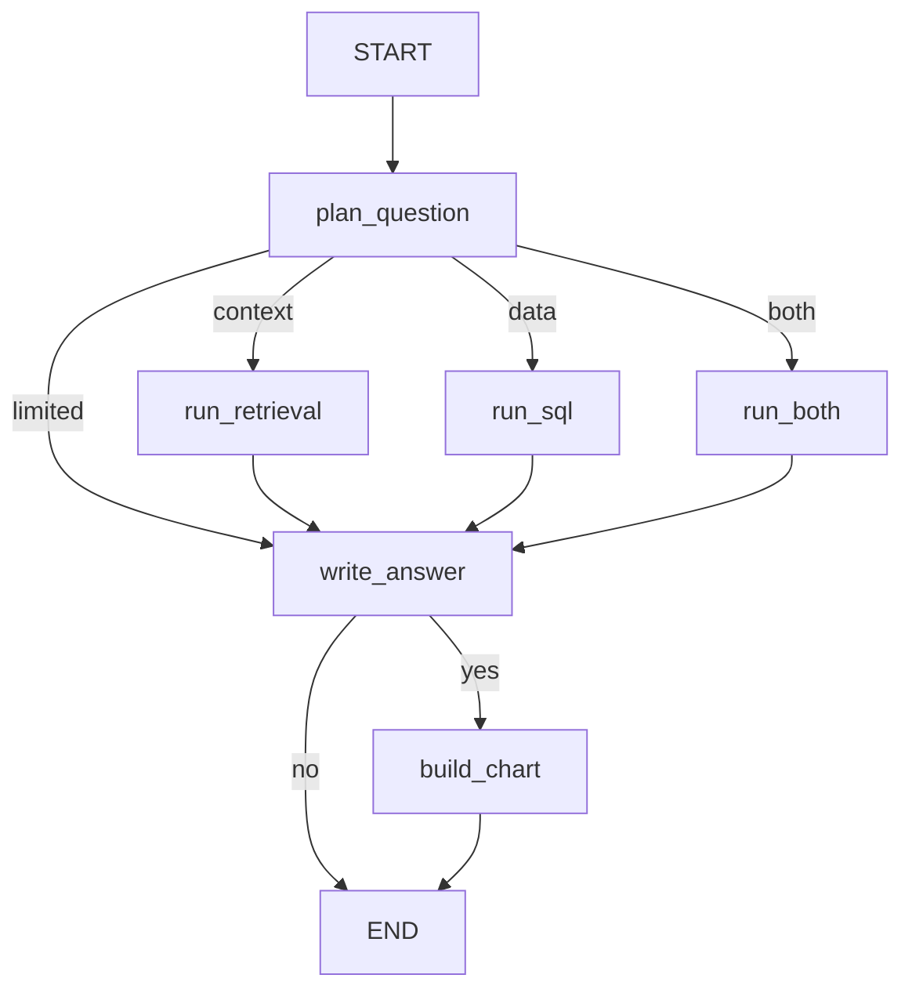

# Tilik

Tilik answers a question about BPS statistics from published observations and the SP2020 demography publication. It does not search the web.

## Pipeline

`compile_graph()` in `tilik_agent.agent` builds this graph. A question enters at `plan_question`. The planner returns a short work plan whose steps are `sql_lookup`, `retrieve_sp2020`, or `calculate`.



- `data` runs SQL lookups only. `context` searches the SP2020 publication only. `both` runs the plan's mix of those steps. `limited` means the plan could not be validated, so the run goes straight to an answer that says so.
- `sql_lookup` is an inner tool agent. It may call `search_datasets`, `describe_dataset`, and `get_observations`. The connection uses the read-only `sql_agent` role. Values are harvested from the tool results. The agent's own reply is only a status.
- `retrieve_sp2020` searches the pgvector collection, grades each excerpt, and rewrites the query up to `retrieval.max_rewrites` times.
- `calculate` proposes arithmetic over observation ids. The result is checked against the stored values before it is kept.
- `write_answer` writes the user-facing answer from the gathered evidence. `build_chart` adds a `ChartSpec` when the question asks for a comparison and at least two cited values exist. The graph returns that spec. It does not open a figure.

The notebook in `notebooks/test_e2e_agent.ipynb` streams the same graph and draws the chart with Plotly. `POST /questions` returns the merged state, including `chart`, for a frontend to draw.

`ChartSpec` fields are `type` (`bar` or `line`), `title`, `x_axis`, `y_axis`, and `data`. Each point has `label`, `series`, `value`, `unit`, and `observation_id`.

## Run a question

Install dependencies and set `.env` from `.env.example`. Postgres must be up, with the observation tables loaded and the SP2020 collection embedded. `SQL_AGENT_PASSWORD` is the password for the read-only role.

```powershell
poetry run tilik serve
```

The API listens on `http://127.0.0.1:4321`. In PowerShell, `--%` keeps the JSON quotes intact:

```powershell
curl.exe --% -s -X POST http://127.0.0.1:4321/questions -H "Content-Type: application/json" -d "{\"question\": \"Provinsi mana saja yang memiliki tiga TPT tertinggi pada Agustus 2025, dan berapa Angka Partisipasi Sekolah kelompok umur 16-18 tahun di masing-masing provinsi tersebut pada 2025?\"}"
```

The body contains `answer`, `chart`, `answer_observation_ids`, `answer_document_ids`, `step_status`, and the error or warning fields `plan_error`, `sql_error`, `sql_warnings`, and `retrieval_error`.

## Configuration

`configs/default.yaml` holds the chat model, embedding model, retrieval limits, dataset-lookup caps, and `graph.recursion_limit`. Editing the file is picked up by the running process. The chat client and SQL agent are rebuilt when the `llm` block changes. The vector store is rebuilt when the embedding model, collection, or connection string changes.

These environment variables override the yaml when they are set: `TILIK_MODEL`, `TILIK_LLM_BASE_URL`, `SP2020_COLLECTION`.

The API key stays in `.env`. The yaml `llm.api_key_env` value names that variable. The default is `OPENAI_API_KEY`. `PGVECTOR_CONNECTION` overrides the pgvector URL. `POSTGRES_HOST`, `POSTGRES_PORT`, and `POSTGRES_DB` select the observation database.

## Ingest

`poetry run tilik ingest catalog` loads the national BPS subject catalog. `poetry run tilik ingest run` loads every catalogued table. `poetry run tilik ingest table --id <bps-table-id>` loads one table. Ingest uses `BPS_API_KEY` and `database_url` from settings, which is separate from the read-only `sql_agent` role used by questions.
