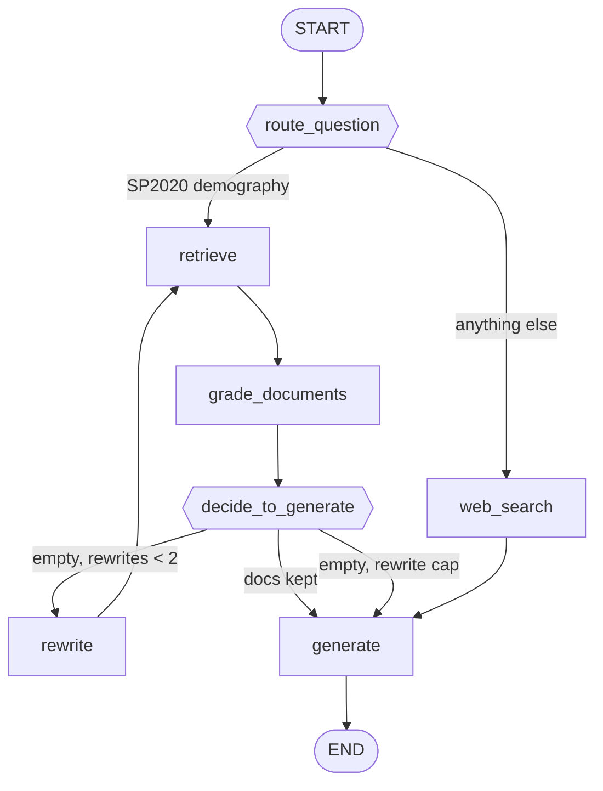

How to run qdrant
You install **two different things**:

1. **Qdrant server** — the database (Docker, binary, or cloud).  
2. **`qdrant-client`** — already in your `pyproject.toml`; install with `poetry install` when you’re ready.

The server is **not** installed via Poetry.

---

## Option A — Docker (usual for local dev on Windows)

**Prerequisites:** [Docker Desktop](https://www.docker.com/products/docker-desktop/) running.

```powershell
docker pull qdrant/qdrant
docker run -p 6333:6333 -p 6334:6334 `
  -v "${PWD}/qdrant_storage:/qdrant/storage" `
  qdrant/qdrant
```

- **REST API:** `http://localhost:6333`  
- **Dashboard:** open `http://localhost:6333/dashboard` in a browser  
- Data persists in `./qdrant_storage` on the host (path is relative to where you run the command).

Stop with `Ctrl+C` or `docker stop <container_id>`.

**Named container (restart easily):**

```powershell
docker run -d --name qdrant `
  -p 6333:6333 -p 6334:6334 `
  -v qdrant_storage:/qdrant/storage `
  qdrant/qdrant
```

---

## Option B — Docker Compose (good for a repo)

Create `docker-compose.yml` at the repo root:

```yaml
services:
  qdrant:
    image: qdrant/qdrant:latest
    ports:
      - "6333:6333"
      - "6334:6334"
    volumes:
      - qdrant_storage:/qdrant/storage

volumes:
  qdrant_storage:
```

Then:

```powershell
docker compose up -d
```

---

## Option C — Qdrant Cloud

Sign up at [https://cloud.qdrant.io](https://cloud.qdrant.io), create a cluster, use the URL + API key. Set env vars, e.g. `QDRANT_URL` and `QDRANT_API_KEY`.

---

## Connect from Python (after server is up)

```python
from qdrant_client import QdrantClient

client = QdrantClient(url="http://localhost:6333")
print(client.get_collections())
```

With LangChain (once deps are installed):

```python
from langchain_qdrant import QdrantVectorStore

# vectorstore = QdrantVectorStore.from_documents(..., url="http://localhost:6333", ...)
```

---

## Quick check

```powershell
curl http://localhost:6333/collections
```

You should get JSON (often an empty `collections` list).

---

**Summary:** Run **`qdrant/qdrant` in Docker** on ports **6333/6334**; use **`poetry install`** only for the Python client. If Docker isn’t an option on your machine, say so and we can outline the Windows native binary path (Docker is still what most people use).