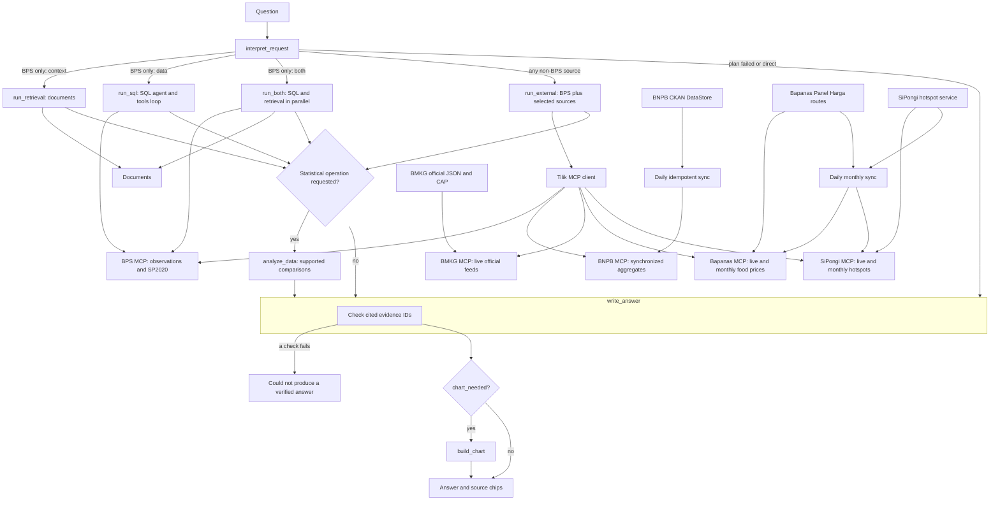

<div align="center">

# Tilik

**Answers Indonesian data questions using BPS, BNPB, BMKG, Bapanas, and SiPongi source connectors.**


</div>

Tilik routes each question to its own BPS, BNPB, BMKG, Bapanas, or SiPongi MCP server. BPS reads published observations and SP2020 passages, BNPB reads synchronized disaster aggregates, and BMKG reads official live feeds. Bapanas reads consumer food prices and SiPongi reads satellite hotspot counts, each both live and from a daily monthly sync. The answer includes cited source links and retrieval times. BPS comparisons can also produce a chart.

## Contents

- [Quick start](#quick-start)
- [Pipeline](#pipeline)
- [Ask a question](#ask-a-question)
- [Configuration](#configuration)
- [Benchmark](#benchmark)
- [Ingest](#ingest)

## Quick start

You need Python 3.11–3.13, [Poetry](https://python-poetry.org/), and Postgres. The observation tables must already be loaded, and the SP2020 chunks must already be in the `bps-sp2020-demografi` pgvector collection.

```powershell
poetry install
copy .env.example .env
poetry run alembic upgrade head
poetry run tilik ingest bnpb
poetry run tilik serve
```

Fill in `.env` before serving. The API listens on [http://127.0.0.1:4321](http://127.0.0.1:4321).

| Variable | Used for |
| --- | --- |
| `OPENAI_API_KEY` | Chat model. `configs/default.yaml` names this variable in `llm.api_key_env`. |
| `SQL_AGENT_PASSWORD` | Read-only `sql_agent` role used while answering. |
| `POSTGRES_PASSWORD` | Password for the `tilik` database role. Required. |
| `BPS_API_KEY` | Catalog and table ingest. |
| `LANGFUSE_PUBLIC_KEY` | Question traces. Leave empty to answer without sending a trace. |
| `LANGFUSE_SECRET_KEY` | Question traces, paired with the public key. |
| `LANGFUSE_BASE_URL` | Optional Langfuse host for question traces. |

`notebooks/test_e2e_agent.ipynb` streams the same graph and draws the chart with Plotly.

The frontend is a Vite app in `frontend`. Start the API first, then:

```powershell
cd frontend
npm install
npm run dev
```

Open [http://localhost:5173](http://localhost:5173). The dev server proxies `/api` to the API on [http://127.0.0.1:4321](http://127.0.0.1:4321).

## Pipeline



Tilik starts the source servers over MCP stdio in local development. Docker Compose
runs the same servers on its internal network over Streamable HTTP. The BPS
server owns the existing read-only SQL and publication search; the agent no
longer opens a BPS SQL connection during answers. The BNPB server uses four
reviewed 2010–2024 CKAN aggregates. The BMKG server uses official forecasts,
earthquake feeds, and active weather warnings without API keys.

BNPB's province and district tables count **all** disaster types. Type-specific
counts are national only; Tilik rejects a province-by-type query. BMKG forecasts
are available for Kemayoran or an explicit validated `adm4` code. Alerts are
filtered by their CAP expiry time. The first BPS+BNPB comparison is limited to
same-year 2024 province values with a confirmed BPS province code.

Bapanas and SiPongi have no documented public API. Tilik calls the same routes
their public pages call, without API keys, and validates every response shape.
Bapanas covers consumer prices: the latest daily price, and monthly province
averages from June 2021. SiPongi covers hotspot counts: the last 12, 24, or 48
hours, and monthly counts by province and district from January 2015. A hotspot
is a satellite heat detection, not a confirmed fire. Satellites change over the
years, so multi-year hotspot series use NASA-MODIS only. Both sources number the
Papua provinces differently from BPS; Tilik maps province names to BPS codes.
The [connector plan](docs/pangan-hotspot-connector-plan.md) records the source
findings.

For a local Poetry run, apply `poetry run alembic upgrade head` and then run
`poetry run tilik ingest bnpb` once. Run `poetry run tilik ingest bapanas` and
`poetry run tilik ingest sipongi` the same way; their first run takes about an
hour and ten minutes respectively, and later runs fetch only unfinished months.
Docker Compose runs the migration and starts a daily idempotent BNPB, Bapanas,
and SiPongi refresh automatically. BMKG is fetched live
and needs no import. The
[implementation plan](CONNECTOR_MIGRATION_PLAN.md) records the file map and
source limitations.

### Local generation smoke test

`.env.local` holds the local secrets and the isolated Postgres port. It is
ignored by Git. The model comes from the `llm` block in `configs/default.yaml`.
Load this file into the shell before running Tilik locally:

```bash
set -a
. ./.env.local
set +a
```

`tests/e2e/test_pipeline_live.py` runs one real `run_question` generation through each of the
BPS, BNPB, BMKG, Bapanas, and SiPongi MCP connectors, and one two-turn chat. It does not call benchmark judges. It
expects a migrated Postgres with BNPB facts and the BPS province density table.
For a fresh database using the settings in `.env.local` (Postgres on `127.0.0.1:5431`):

```bash
docker compose --env-file .env.local -f docker-compose.yml -f docker-compose.dev.yml up -d postgres
poetry run alembic upgrade head
poetry run tilik ingest bnpb
poetry run tilik ingest bapanas
poetry run tilik ingest sipongi
poetry run tilik ingest catalog
poetry run tilik ingest table --id 'MTQxIzI='
.venv/bin/python -m pytest tests/e2e/test_pipeline_live.py
```

The BPS table import needs `BPS_API_KEY` in `.env`. The BPS smoke question uses
its published 2021 DKI Jakarta density value. Other BPS questions need their
own tables ingested first. The database keeps its data in the
`tilik-agent_pgvector_storage` volume; stop it with
`docker compose -f docker-compose.yml -f docker-compose.dev.yml stop postgres`.

## Ask a question

`POST /questions` with a JSON body. Omit `sources` for automatic routing, or
pass one or two of `bps`, `bnpb`, `bmkg`, `bapanas`, and `sipongi` to limit the connectors.

```json
{ "question": "Provinsi mana saja yang memiliki tiga TPT tertinggi pada Agustus 2025?" }
```

For example, `{"question": "Berapa kejadian banjir nasional pada 2024?", "sources": ["bnpb"]}`
queries BNPB. `{"question": "Gempa terbaru menurut BMKG?", "sources": ["bmkg"]}`
queries BMKG's live feed. `{"question": "Harga cabai rawit hari ini?", "sources": ["bapanas"]}`
queries Bapanas, and `{"question": "Titik panas 24 jam terakhir?", "sources": ["sipongi"]}`
queries SiPongi.

```bash
curl -s -X POST http://127.0.0.1:4321/questions \
  -H "Content-Type: application/json" \
  -d '{"question": "Provinsi mana saja yang memiliki tiga TPT tertinggi pada Agustus 2025, dan berapa Angka Partisipasi Sekolah kelompok umur 16-18 tahun di masing-masing provinsi tersebut pada 2025?"}'
```

PowerShell parses JSON quotes unless you stop it:

```powershell
curl.exe --% -s -X POST http://127.0.0.1:4321/questions -H "Content-Type: application/json" -d "{\"question\": \"Provinsi mana saja yang memiliki tiga TPT tertinggi pada Agustus 2025, dan berapa Angka Partisipasi Sekolah kelompok umur 16-18 tahun di masing-masing provinsi tersebut pada 2025?\"}"
```

| Field | Meaning |
| --- | --- |
| `answer` | Text shown to the user. |
| `sources` | Cited BPS datasets/publications or external source links and freshness details. |
| `used_connectors` | Source connectors selected for this answer. |
| `chart` | Chart spec, or `null`. |
| `answer_observation_ids` | Observation ids cited in the answer. |
| `answer_document_ids` | Publication document ids cited in the answer. |
| `step_status` | Status of each planned step. |
| `plan_error` | Set when the plan could not be validated. |
| `sql_error` | Set when a SQL step failed. |
| `sql_warnings` | Non-fatal SQL notes, such as a tool-round cap. |
| `retrieval_error` | Set when publication search failed. |

A chart spec has `type` (`bar` or `line`), `title`, `x_axis`, `y_axis`, and `data`. Each point has `label`, `series`, `value`, `unit`, and `observation_id`.

## Configuration

`configs/default.yaml` holds the chat model, the embedding model, retrieval limits, dataset-lookup caps, and `graph.recursion_limit`. Saving the file is picked up by the running process. The chat client and SQL agent are rebuilt when the `llm` block changes. The vector store is rebuilt when the embedding model, collection, or connection string changes.

| Block | What you can change |
| --- | --- |
| `llm` | `model`, `base_url`, `temperature`, `api_key_env`, `extra_body` |
| `embedding` | `model`, `device`, `normalize_embeddings` |
| `retrieval` | `collection`, `top_k`, `max_rewrites` |
| `dataset_lookup` | `max_search_results`, `max_measures`, `max_dimension_members`, `max_periods`, `max_observations`, `max_tool_rounds` |
| `graph` | `recursion_limit` |
| `evals` | Judge model and which benchmark metrics are enabled. The question agent keeps using `llm`. |

These variables override the file when they are set:

| Variable | Overrides |
| --- | --- |
| `RETRIEVAL_COLLECTION` | `retrieval.collection`. `SP2020_COLLECTION` remains accepted for existing environments. |
| `PGVECTOR_CONNECTION` | Optional pgvector URL. When unset, the app uses the same URL as the observation database. |
| `POSTGRES_HOST`, `POSTGRES_PORT`, `POSTGRES_DB`, `POSTGRES_USER`, `POSTGRES_PASSWORD` | Observation database used by SQL lookup. The password is required in `.env`. |
| `TILIK_BPS_MCP_URL`, `TILIK_BNPB_MCP_URL`, `TILIK_BMKG_MCP_URL`, `TILIK_BAPANAS_MCP_URL`, `TILIK_SIPONGI_MCP_URL` | Optional internal Streamable HTTP server URLs. Without them, Tilik starts local stdio servers. |

Secrets stay in `.env`. The yaml file only names the API-key variable.

## Benchmark

For manual connector acceptance, use the source and limitation cases in
`src/tilik_agent/evals/datasets/connector_questions.json`. BMKG, Bapanas, and
SiPongi values change live, so their cases check source choice, freshness, and
wording rather than fixed numbers.

`poetry run tilik benchmark` runs the judges on the whole question file. It answers each question in `src/tilik_agent/evals/datasets/generation_benchmark.json` through the same `run_question` path as the API, then scores the metrics whose `enabled` flag is true under `evals.metrics`. It prints each question as it starts. A Langfuse trace for that question is sent when the agent finishes answering, before the judges run. `POST /questions` and the notebook trace the question and do not call the judges.

To score one question, edit `QUESTION` in `examples/eval_question.py` and run `poetry run python examples/eval_question.py`. It prints the answer and the same scores, and it does not upload a Langfuse dataset run.

`task_completion` and `argument_correctness` are referenceless LLM judges. They use `evals.judge`, which starts as a copy of the Qwen settings. `pipeline_status` records whether the planned steps succeeded, partially succeeded, or failed. It is not a judge.

When both Langfuse keys are set, the command upserts that JSON file into a Langfuse dataset and stores the enabled scores on a dataset run named with the file's `version`. Without the keys, it prints the scores and skips the upload.

`poetry run tilik benchmark --conversations` replays the scripted user turns in `src/tilik_agent/evals/datasets/demografi_sosial_conversations.json`. Each new turn receives the earlier generated replies as history, and the run reports one score row per conversation. `evals.conversation_metrics` enables goal accuracy, tool use, conversation completeness, and pipeline status by default. Turn relevancy is available but off by default. The judge scores are referenceless; `expected_outcome` is kept for human review and is not a scored reference answer. When Langfuse is configured, each conversation uses one trace session and its transcript is stored as the experiment output.

Conversation judges receive the recorded tool names, arguments, descriptions, and full outputs. The judge therefore has the same tool-result context as the trace. A provider may reject an item if its judge prompt exceeds that provider's limits.

Use `--n-samples 3` with either benchmark mode to run three items, and `--seed 42` to repeat the same selection. Without `--n-samples`, every item runs. A sampled run still syncs the full dataset to Langfuse, so unsampled items stay available; only the selected items consume model calls and appear in that experiment.

Sampling reduces the number of conversations or questions, but each item can still exceed the provider's per-request or per-minute token limits.

`poetry run tilik benchmark --judges` checks the judges themselves against human labels. The agent does not run. `src/tilik_agent/evals/datasets/judge_benchmark.json` holds 33 saved answers from the chat database and Langfuse. Each item has the question, earlier turns, the frozen `generated_response` and `generated_tool_calls`, a hand-written `expected_response`, and a `human_label` (pass or fail, with a reason). The answers stay frozen so a human label always describes the same text. `judge_benchmark_traces.json` beside it holds each item's recorded trajectory and full tool results, which the judges read. For the 25 items recorded before connector calls were traced as tools, the tool calls are rebuilt from the plan saved in the trace.

The command scores every item with `task_completion` and `argument_correctness`, writes the judge labels back into the dataset file, and prints how often each judge agrees with the human label. `argument_correctness` is not counted for an item without tool calls, because it passes such items by default. When Langfuse is configured, the command upserts the `judge-benchmark` dataset. Each item's input holds the question, the generated answer, the tool calls, and the judged trajectory, and the item links to its original trace. The command then publishes a run with `task_completion`, `argument_correctness`, `human_label`, and `*_agrees` scores. Averaged over the run, `*_agrees` is that judge's accuracy. The run metadata records the judge model, temperature, thresholds, DeepEval version, and code commit. `--n-samples` does not apply to this mode.

The judge in `configs/default.yaml` calls Orvix with `OPENAI_API_KEY`, so load `.env.local` first:

```bash
set -a; . ./.env.local; set +a
poetry run tilik benchmark --judges
```

## Ingest

Ingest writes through `database_url`, built from `POSTGRES_USER`, `POSTGRES_PASSWORD`, and the host settings in `.env`. That role is separate from the read-only `sql_agent` role used by questions.

| Command | Effect |
| --- | --- |
| `poetry run tilik ingest catalog` | Load the national BPS subject catalog. |
| `poetry run tilik ingest bnpb` | Sync the four reviewed BNPB disaster aggregates through public CKAN DataStore. Safe to repeat. |
| `poetry run tilik ingest run` | Load every catalogued table. A stopped run resumes finished periods. |
| `poetry run tilik ingest table --id <bps-table-id>` | Load one catalogued table, including every published year. |
| `poetry run tilik ingest pdf --pdf <path> --collection <name>` | Chunk any text PDF and replace the named pgvector collection. Set `RETRIEVAL_COLLECTION` to that name when the question agent should search it. |
