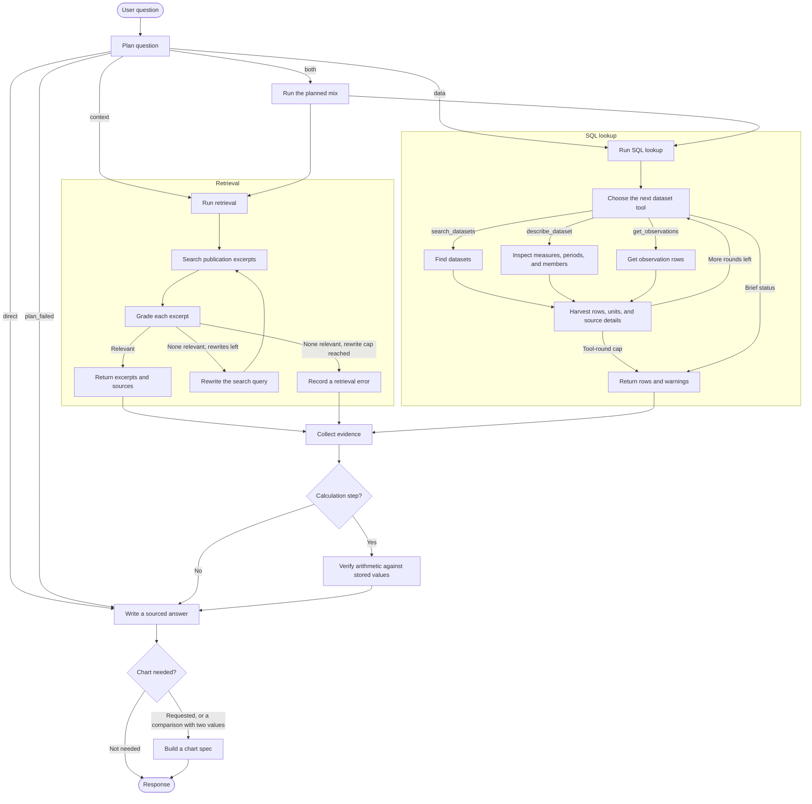

<div align="center">

# Tilik

**Answers a question about BPS statistics from published observations and the SP2020 demography publication.**


</div>

Tilik plans the work, looks up figures in Postgres, searches the publication in pgvector, and writes an answer with the observation and document ids it used. When the question asks for a comparison, the response also includes a chart spec a notebook or frontend can draw. It does not search the web.

## Contents

- [Quick start](#quick-start)
- [Pipeline](#pipeline)
- [Ask a question](#ask-a-question)
- [Configuration](#configuration)
- [Benchmark](#benchmark)
- [Ingest](#ingest)

## Quick start

You need Python 3.11–3.13, [Poetry](https://python-poetry.org/), and Postgres. The observation tables must already be loaded, and the SP2020 chunks must already be in the `bps-sp2020-demografi` pgvector collection.

```powershell
poetry install
copy .env.example .env
poetry run tilik serve
```

Fill in `.env` before serving. The API listens on [http://127.0.0.1:4321](http://127.0.0.1:4321).

| Variable | Used for |
| --- | --- |
| `OPENAI_API_KEY` | Chat model. `configs/default.yaml` names this variable in `llm.api_key_env`. |
| `SQL_AGENT_PASSWORD` | Read-only `sql_agent` role used while answering. |
| `POSTGRES_PASSWORD` | Password for the `tilik` database role. Required. |
| `BPS_API_KEY` | Catalog and table ingest. |
| `LANGFUSE_PUBLIC_KEY` | Question traces. Leave empty to answer without sending a trace. |
| `LANGFUSE_SECRET_KEY` | Question traces, paired with the public key. |
| `LANGFUSE_BASE_URL` | Optional Langfuse host for question traces. |

`notebooks/test_e2e_agent.ipynb` streams the same graph and draws the chart with Plotly.

The frontend is a Vite app in `frontend`. Start the API first, then:

```powershell
cd frontend
npm install
npm run dev
```

Open [http://localhost:5173](http://localhost:5173). The dev server proxies `/api` to the API on [http://127.0.0.1:4321](http://127.0.0.1:4321).

## Pipeline

`compile_graph()` in `tilik_agent.agent` builds the graph below. `plan_question` returns a short plan whose steps are `sql_lookup`, `retrieve_document`, or `calculate`. A `both` plan runs the retrieval and SQL loops. A calculation waits until the steps it depends on have finished.



| Route | What runs |
| --- | --- |
| `data` | SQL lookups only. |
| `context` | Search the configured publication collection only. |
| `both` | The plan's mix of SQL lookups and publication search. |
| `direct` | No SQL or publication lookup is needed; the answer writer responds from conversation and any gathered evidence. |
| `plan_failed` | The plan did not validate, so the run goes straight to an answer that says so. |

| Step | What it does |
| --- | --- |
| `sql_lookup` | Inner tool agent. It may call `search_datasets`, `describe_dataset`, and `get_observations` through the read-only `sql_agent` role. Values are harvested from the tool results. The agent's reply is only a status. |
| `retrieve_document` | Searches the configured pgvector collection, grades each excerpt, and rewrites the query up to `retrieval.max_rewrites` times. |
| `calculate` | Proposes arithmetic over observation ids. The result is checked against the stored values before it is kept. |
| `write_answer` | Writes the answer from the gathered evidence. |
| `build_chart` | Adds a chart spec when the question asks for a comparison and at least two cited values exist. The graph returns the spec and does not open a figure. |

### Dataset search

`search_datasets` splits the query into words, lowercased and separated at anything that is not a letter or digit. A four-digit word is treated as a year. Every other word is matched on its own against the dataset title and its measure names, so a query does not need to match a title as one phrase.

Each dataset gets 2 points for every word found in its title, and 1 point for every word found only in its measure names. Datasets with no points are left out. The rest are ordered by:

1. Parsed datasets first.
2. Higher score.
3. Datasets with an observation in a requested year.
4. Shorter title, because it is usually the more specific table.
5. Dataset id.

The first `dataset_lookup.max_search_results` rows are returned, and `truncated` is true when that limit is reached. A query that is only a year returns nothing, because years only rank results.

All words count the same. Weighting rare words more (IDF) was tried on the benchmark questions, and it did worse: rare words such as "nasional" pulled in unrelated tables. Words that never appear in a title, such as English terms or region names like "Jakarta", do not match.

## Ask a question

`POST /questions` with a JSON body. The server streams the graph and returns the merged state.

```json
{ "question": "Provinsi mana saja yang memiliki tiga TPT tertinggi pada Agustus 2025?" }
```

```bash
curl -s -X POST http://127.0.0.1:4321/questions \
  -H "Content-Type: application/json" \
  -d '{"question": "Provinsi mana saja yang memiliki tiga TPT tertinggi pada Agustus 2025, dan berapa Angka Partisipasi Sekolah kelompok umur 16-18 tahun di masing-masing provinsi tersebut pada 2025?"}'
```

PowerShell parses JSON quotes unless you stop it:

```powershell
curl.exe --% -s -X POST http://127.0.0.1:4321/questions -H "Content-Type: application/json" -d "{\"question\": \"Provinsi mana saja yang memiliki tiga TPT tertinggi pada Agustus 2025, dan berapa Angka Partisipasi Sekolah kelompok umur 16-18 tahun di masing-masing provinsi tersebut pada 2025?\"}"
```

| Field | Meaning |
| --- | --- |
| `answer` | Text shown to the user. |
| `chart` | Chart spec, or `null`. |
| `answer_observation_ids` | Observation ids cited in the answer. |
| `answer_document_ids` | Publication document ids cited in the answer. |
| `step_status` | Status of each planned step. |
| `plan_error` | Set when the plan could not be validated. |
| `sql_error` | Set when a SQL step failed. |
| `sql_warnings` | Non-fatal SQL notes, such as a tool-round cap. |
| `retrieval_error` | Set when publication search failed. |

A chart spec has `type` (`bar` or `line`), `title`, `x_axis`, `y_axis`, and `data`. Each point has `label`, `series`, `value`, `unit`, and `observation_id`.

## Configuration

`configs/default.yaml` holds the chat model, the embedding model, retrieval limits, dataset-lookup caps, and `graph.recursion_limit`. Saving the file is picked up by the running process. The chat client and SQL agent are rebuilt when the `llm` block changes. The vector store is rebuilt when the embedding model, collection, or connection string changes.

| Block | What you can change |
| --- | --- |
| `llm` | `model`, `base_url`, `temperature`, `api_key_env`, `extra_body` |
| `embedding` | `model`, `device`, `normalize_embeddings` |
| `retrieval` | `collection`, `top_k`, `max_rewrites` |
| `dataset_lookup` | `max_search_results`, `max_measures`, `max_dimension_members`, `max_periods`, `max_observations`, `max_tool_rounds` |
| `graph` | `recursion_limit` |
| `evals` | Judge model and which benchmark metrics are enabled. The question agent keeps using `llm`. |

These variables override the file when they are set:

| Variable | Overrides |
| --- | --- |
| `TILIK_MODEL` | `llm.model` |
| `TILIK_LLM_BASE_URL` | `llm.base_url` |
| `RETRIEVAL_COLLECTION` | `retrieval.collection`. `SP2020_COLLECTION` remains accepted for existing environments. |
| `PGVECTOR_CONNECTION` | Optional pgvector URL. When unset, the app uses the same URL as the observation database. |
| `POSTGRES_HOST`, `POSTGRES_PORT`, `POSTGRES_DB`, `POSTGRES_USER`, `POSTGRES_PASSWORD` | Observation database used by SQL lookup. The password is required in `.env`. |

Secrets stay in `.env`. The yaml file only names the API-key variable.

## Benchmark

`poetry run tilik eval` runs the judges on the whole question file. It answers each question in `src/tilik_agent/evals/datasets/demografi_sosial_questions.json` through the same `run_question` path as the API, then scores the metrics whose `enabled` flag is true under `evals.metrics`. It prints each question as it starts. A Langfuse trace for that question is sent when the agent finishes answering, before the judges run. `POST /questions` and the notebook trace the question and do not call the judges.

To score one question, edit `QUESTION` in `examples/eval_question.py` and run `poetry run python examples/eval_question.py`. It prints the answer and the same scores, and it does not upload a Langfuse dataset run.

`task_completion` and `argument_correctness` are referenceless LLM judges. They use `evals.judge`, which starts as a copy of the Qwen settings. `pipeline_status` records whether the planned steps succeeded, partially succeeded, or failed. It is not a judge.

When both Langfuse keys are set, the command upserts that JSON file into a Langfuse dataset and stores the enabled scores on a dataset run named with the file's `version`. Without the keys, it prints the scores and skips the upload.

## Ingest

Ingest writes through `database_url`, built from `POSTGRES_USER`, `POSTGRES_PASSWORD`, and the host settings in `.env`. That role is separate from the read-only `sql_agent` role used by questions.

| Command | Effect |
| --- | --- |
| `poetry run tilik ingest catalog` | Load the national BPS subject catalog. |
| `poetry run tilik ingest run` | Load every catalogued table. A stopped run resumes finished periods. |
| `poetry run tilik ingest table --id <bps-table-id>` | Load one catalogued table, including every published year. |
| `poetry run tilik ingest pdf --pdf <path> --collection <name>` | Chunk any text PDF and replace the named pgvector collection. Set `RETRIEVAL_COLLECTION` to that name when the question agent should search it. |
